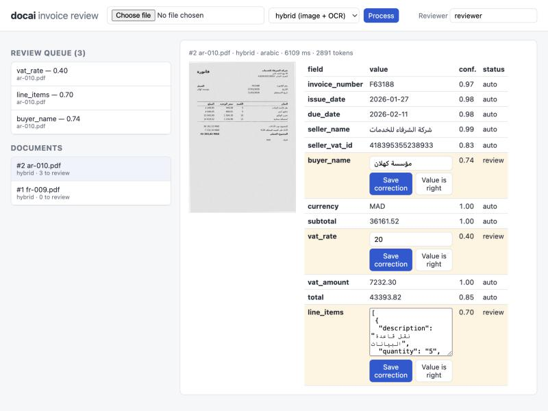
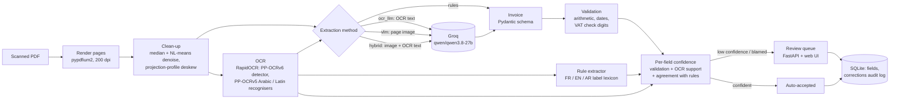

# doc-ai-pipeline

[](https://github.com/sinouw/doc-ai-pipeline/actions/workflows/ci.yml)

Scanned invoice PDFs in French, English and Arabic in, validated JSON out, with a confidence score on every field and a review queue for the fields a person should check.

The pipeline cleans up each page (denoise, deskew), runs OCR, extracts the invoice with a vision LLM on Groq, checks the result (line items add up to the subtotal, VAT matches the rate, the total matches, dates parse, VAT numbers pass their check digits) and scores each field. Fields below the confidence threshold, or blamed by a failed check, go to a small web app where a reviewer corrects or confirms them. Corrections are stored with the old value, the new value, who made them and when.

It ships with a synthetic labelled set of scanned invoices and an evaluation that compares five extraction strategies (two of them without any LLM) on accuracy, latency and cost. Every number in this README comes from the committed run in [`results/`](results/).

<!-- RESULTS:START -->


*A real `hybrid` extraction of the Moroccan test invoice `ar-010` (2,475 input / 416 output tokens, 6.1 s end to end). All 12 fields match the label. Three correct fields are still waiting for review because the model-free OCR rules could not confirm them. That is the price of the conservative threshold: see the review routing table.*

## Results

Measured on 2026-10-28 by [`results/2026-10-28-test`](results/2026-10-28-test) ([report](results/2026-10-28-test/report.md), [raw records](results/2026-10-28-test/records.jsonl)). LLM: `qwen/qwen3.8-27b` on Groq's free tier, temperature 0. Hardware: MacBook Pro 2019, Intel Core i7-9750H (6 cores / 12 threads), 16 GB RAM, CPU only, pages processed one at a time, peak memory 887 MB.

All five methods ran on the same 18 test invoices (6 French, 6 English, 6 Arabic; 216 fields). The free tier's 200k tokens/day cap for this model is why the LLM comparison uses 18 of the 36 test documents rather than all of them; the OCR-only methods also ran on all 36 (below).

| Method | Field accuracy | Invoice fully correct | Arabic field accuracy | Latency p50 / p95 per page | Tokens in / out per page | Cost per 1,000 pages |
|---|---|---|---|---|---|---|
| OCR + rules, no clean-up | 77.3% | 44.4% | 43.1% | 4.5 / 5.0 s | 0 | $0 |
| OCR + rules | 82.4% | 50.0% | 51.4% | 5.1 / 6.3 s | 0 | $0 |
| OCR text → LLM | 94.0% | 61.1% | 83.3% | 9.4 / 16.0 s | 656 / 363 | $1.98 |
| Vision LLM (image only) | 97.2% | 72.2% | 94.4% | 9.9 / 13.7 s | 2,163 / 370 | $3.21 |
| **Hybrid (image + OCR text)** | **99.1%** | **88.9%** | **97.2%** | 8.7 / 13.7 s | 2,449 / 372 | $3.45 |

- **Hybrid is best or tied for best in every language and at every degradation level.** It is the only method with no error on numbers, dates or tax ids (OCR + rules does read seller names better: 100% vs 94.4%). Its two wrong fields are one-letter misreads of Arabic company names (`بديرة` for `بديرية`, `سرنج` for `سرندح`). With heavy degradation it still scored 100% of fields, against 94.4% for the vision model alone and 76.4% for OCR + rules.
- **The OCR transcript is what fixes identifiers.** VAT id accuracy: 72.2% from OCR text alone, 94.4% from the image alone, 100% with both.
- **Clean-up helps OCR.** Denoise + deskew lifts OCR + rules from 77.3% to 82.4% of fields (36 documents: 79.4% to 82.6%). Deskew lands within 0.03° of the true rotation on average. (The clean-up was not ablated for the LLM methods.)
- **French and English are nearly solved without an LLM.** OCR + rules scores 100% of French fields and 95.8% of English ones. Arabic (43–51%) is where the LLM earns its cost.
- **Latency** is wall clock per page minus time spent sleeping on HTTP 429 back-offs (raw figures are in `summary.json`). Every method includes rendering, clean-up and OCR, about 5 s on this CPU; OCR stays in the vision-only path because confidence scoring uses it. **Cost** uses Groq's list price for the model ($0.80 / $4.00 per million input / output tokens, read 2026-10-28). The run itself was on the free tier. The whole LLM evaluation used 114,687 tokens.

### Review routing and validation

At the default threshold of 0.8, the hybrid method sends 13.0% of fields to a reviewer, **catches both of its wrong fields**, and the 87% of fields it auto-accepts are all correct. The queue is conservative: most of what it holds is correct values that a second signal could not confirm.

| Method (threshold 0.8) | Fields sent to review | Wrong fields caught | Auto-accepted fields correct |
|---|---|---|---|
| OCR + rules | 19.0% | 97.4% (1 missed) | 99.4% |
| OCR text → LLM | 13.4% | 100% | 100% |
| Vision LLM | 13.9% | 100% | 100% |
| Hybrid | 13.0% | 100% | 100% |

Three of the 18 invoices print a total that does not add up. All three LLM methods flagged all three and raised no arithmetic flag on the 15 consistent ones. OCR + rules flagged 2 of 3 and raised false flags on 3 consistent invoices, caused by its own extraction errors. Full tables per language, degradation level, field and threshold are in the [report](results/2026-10-28-test/report.md).

**OCR-only methods on all 36 test invoices:** OCR + rules 82.6% of fields (French 100%, English 95.8%, Arabic 52.1%), 52.8% of invoices fully correct, 4.9 s per page p50. Without clean-up: 79.4% and 44.4%.
<!-- RESULTS:END -->

## Architecture



| Module | Role |
|---|---|
| [`imaging.py`](src/docai/imaging.py) | PDF rasterisation, median + non-local-means denoising, deskew by maximising the variance of the horizontal projection profile (coarse 0.5° then 0.1° search) |
| [`ocr.py`](src/docai/ocr.py) | RapidOCR (PaddleOCR models on ONNX Runtime, CPU). Runs the Arabic recogniser first and switches to the Latin one when under 5% of the letters are Arabic. Groups boxes into rows in reading order (right to left for Arabic) |
| [`rules.py`](src/docai/rules.py) | OCR-only baseline: label lexicon in three languages plus patterns for VAT ids, dates and amounts. No model call |
| [`extract.py`](src/docai/extract.py) | Prompt, message building for the three LLM methods, and coercion of the model's JSON into the schema (locale-aware number and date parsing instead of trusting the model's formatting) |
| [`llm.py`](src/docai/llm.py) | Groq OpenAI-compatible client: JSON mode, temperature 0, retries on 429/5xx honouring `retry-after`, token and back-off accounting |
| [`parsing.py`](src/docai/parsing.py) | `1 234,56`, `1,234.56`, `1.234,56`, three-decimal dinars (`288,760`), Arabic-Indic digits, French and English month names |
| [`validate.py`](src/docai/validate.py) | Cross-field checks. A field that takes part in a passing check is corroborated; one that only takes part in failing checks is blamed |
| [`confidence.py`](src/docai/confidence.py) | Weighted mean of three signals: validation (0.4), OCR support (0.3), agreement with the rule extractor (0.3) |
| [`store.py`](src/docai/store.py), [`api.py`](src/docai/api.py), [`static/`](src/docai/static) | SQLite store, FastAPI endpoints, plain HTML/JS review UI |

### Design trade-offs

- **Hybrid input.** The vision model reads layout and Arabic script better than the OCR engine on degraded scans, while the OCR transcript pins down digits and ids. Sending both cost 286 extra input tokens per page (2,449 vs 2,163) and bought 1.9 points of field accuracy and 16.7 points of fully correct invoices.
- **Confidence from independent evidence, not from the model.** LLM self-reported confidence tends to be poorly calibrated, so the pipeline does not ask for it. Here a field is trusted when it is corroborated by arithmetic, can be found in the OCR output, and matches what a model-free extractor found. Arithmetic is the strongest signal: wrong digits rarely still add up.
- **Report what is printed, flag what is wrong.** The prompt forbids the model from correcting totals, and validation never rewrites a value. An invoice whose total does not add up is a finding for a person, not something to repair silently.
- **Parse numbers ourselves.** The model is asked for plain decimals, but the coercion layer still parses locale formats, so `1 234,560 TND` stays 1234.560 and not 1234560.
- **OCR on CPU, in-process.** RapidOCR runs PaddleOCR's mobile models (under 50 MB) on ONNX Runtime: no PyTorch, no GPU and no system packages. That keeps the Docker image and CI simple and runs on a 2019 Intel laptop. Tesseract with `fra`/`ara` packs was the other candidate. It needs a system install, which this development machine does not have, so it was not measured here. The OCR engine sits behind a small protocol (`OcrEngine` in `ocr.py`), so swapping engines means writing one adapter.
- **One synchronous request per upload.** The API processes the PDF inside the request (in a worker thread). That is fine for a review tool; a production intake would put a queue in front of it.

## Dataset

[`data/test`](data/test) holds 36 single-page scanned invoices (12 French, 12 English, 12 Arabic) and [`data/dev`](data/dev) 18 more. All of it is synthetic and generated by [`eval/generate_dataset.py`](eval/generate_dataset.py). There is no real personal or customer data in this repository.

- Company and person names come from [Faker](https://github.com/joke2k/faker) (`fr_FR`, `en_GB`, `ar_AA`), amounts and dates are random, and VAT ids are random but carry valid check digits (French FR key, UK mod-97, Irish check letter) or the right format (Tunisian matricule fiscal, Moroccan ICE).
- Currencies: EUR, GBP, TND (three decimals) and MAD. Number styles follow the locale. About a third of the Arabic invoices print their dates in Arabic-Indic digits.
- Each page is rendered with the DejaVu fonts bundled with matplotlib (DejaVu font licence), then degraded at one of three levels: rotation up to ±4°, Gaussian blur, sensor noise, salt-and-pepper speckle, grey paper and JPEG compression. It is saved as an image-only PDF, so there is no text layer to read.
- Three test invoices (one per language) print a total that does not equal subtotal + VAT. The label holds the printed value, and the validation table measures whether those documents get flagged.
- The JSON next to each PDF is the label: the printed values in the schema, plus metadata (language, degradation level, rotation, injected error).

The rules and prompts were written while looking only at the dev split. The test split was generated with a different seed and is only used by the evaluation. The dataset is released under the same MIT licence as the code.

## Evaluation method

`eval/run_eval.py` sends every test document once through render, clean-up and OCR, then runs each extraction method on that shared result and scores it against the label:

| Method | What the extractor sees |
|---|---|
| `rules_raw` | OCR of the raw page (no denoise or deskew) + rules. Measures what the clean-up buys |
| `rules` | OCR of the cleaned page + rules. No LLM |
| `ocr_llm` | OCR transcript only, sent to the LLM |
| `vlm` | Page image only, sent to the vision LLM |
| `hybrid` | Page image + OCR transcript |

The three LLM methods use the same model, prompt and settings, so the difference between them is the input. Scoring is field by field over 12 fields: ids compared without spaces and case, names after Unicode normalisation and case folding, dates as dates, amounts as numbers (to 0.0005), and line items as a whole (same count, and the same quantity, unit price and amount on every line). Document exact match means all 12 fields are right.

Raw per-document records (prediction, label, per-field confidence and signals, validation issues, tokens, timings) are in `records.jsonl`. `summary.json` is computed from them (`eval/run_eval.py --summarize`) and `report.md` from that (`eval/report.py`).

## Run it

Requirements: Python 3.12 and [uv](https://docs.astral.sh/uv/), plus a free Groq API key for the LLM methods (`rules` works without one). The OCR models (under 50 MB) download on first use.

```bash
cp .env.example .env        # then set GROQ_API_KEY
uv sync
uv run docai serve          # review app on http://127.0.0.1:8000
```

Extract one file from the command line:

```bash
uv run docai process data/test/fr-001.pdf --method hybrid
```

With Docker (the image downloads the OCR models at build time):

```bash
docker build -t docai .
docker run --rm -p 8000:8000 --env-file .env -v docai-data:/data docai
```

Reproduce the evaluation:

```bash
uv run python eval/run_eval.py --split data/test --out results/my-run --methods rules,rules_raw
uv run python eval/run_eval.py --split data/test --out results/my-run --methods ocr_llm,vlm,hybrid \
  --per-language 6 --resume --token-budget 180000
uv run python eval/report.py results/my-run
# optional: regenerate the dataset (same pixels; only the PDF timestamps differ)
uv run --group datagen python eval/generate_dataset.py --out data/test --per-language 12 --seed 2
```

The runner paces calls from Groq's rate-limit headers, stops cleanly when the daily token cap is reached (rerun with `--resume` later; finished records are never redone) and, with `DOCAI_LLM_CACHE=var/llm-cache`, caches every model response on disk so a crash never pays for the same call twice.

Development checks, the same ones CI runs:

```bash
uv run ruff check . && uv run ruff format --check . && uv run mypy && uv run pytest
```

### API

| Endpoint | |
|---|---|
| `POST /api/documents` | multipart `file` (PDF, 20 MB max) and `method` (`hybrid` by default). Returns the document with per-field values, confidence, signals and issues |
| `GET /api/documents`, `GET /api/documents/{id}` | list, detail |
| `GET /api/documents/{id}/pages/{n}` | cleaned page image |
| `GET /api/review` | fields waiting for review, lowest confidence first |
| `POST /api/fields/{id}/resolve` | `{"reviewer": "...", "action": "correct", "value": ...}` or `{"reviewer": "...", "action": "confirm"}`. The value is validated against the field's schema type |
| `GET /api/corrections` | audit log of every review decision |

## Limitations

<!-- LIMITATIONS:START -->
- **Synthetic, template-generated data.** All invoices come from one renderer with per-language layouts, two fonts and simulated scan damage. Real invoices vary far more (logos, stamps, handwriting, multi-column layouts, photos taken with a phone), so treat these numbers as a controlled comparison between methods, not as production accuracy.
- **Small sample.** The LLM comparison covers 18 invoices and 216 fields: one wrong field moves field accuracy by 0.46 points, and the per-language slices have 6 documents each. The free-tier daily token cap set that size.
- **Single-page documents only were evaluated.** The pipeline handles up to 5 pages (all page images go to the model and line items are merged across pages), but no multi-page invoice is in the test set.
- **The confidence weights and threshold are hand-set**, not fitted on data. The routing table shows the trade-off: no missed errors at 0.8, at the cost of reviewing about 13% of fields, most of them correct.
- **The OCR baseline is simple.** The rules were written against the dev split and are weak on Arabic; a layout-aware extractor would close part of the gap at zero token cost. For Latin-script pages, OCR runs twice (Arabic recogniser first to detect the script, then the Latin one).
- **`qwen/qwen3.8-27b` is a preview model on Groq**, and the only vision model Groq lists today. Tesseract was not compared because it is not installed on the development machine.
- **The review app has no authentication** and processes uploads synchronously; it is a reviewer's tool, not a multi-tenant service.
- **CI covers the build, not a running container.** GitHub Actions runs lint, mypy --strict, the unit tests, the real-OCR integration test and `docker build` (which also runs one OCR pass per script). Nobody has started the container and processed a document in it yet, because Docker is not installed on the development machine.
<!-- LIMITATIONS:END -->

## Licence

MIT, see [LICENSE](LICENSE).
