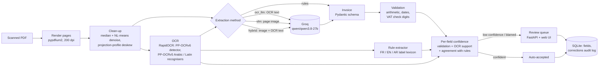

# doc-ai-pipeline

Scanned invoice PDFs in French, English and Arabic in, validated JSON out, with a confidence score on every field and a review queue for the fields a person should check.

The pipeline cleans up each page (denoise, deskew), runs OCR, extracts the invoice with a vision LLM on Groq, checks the result (line items add up to the subtotal, VAT matches the rate, the total matches, dates parse, VAT numbers pass their check digits) and scores each field. Fields below the confidence threshold, or blamed by a failed check, go to a small web app where a reviewer corrects or confirms them. Corrections are stored with the old value, the new value, who made them and when.

It ships with a synthetic labelled set of scanned invoices and an evaluation that compares four extraction strategies on accuracy, latency and cost. Every number in this README comes from the committed run in [`results/`](results/).

<!-- RESULTS:START -->
<!-- RESULTS:END -->

## Architecture



| Module | Role |
|---|---|
| [`imaging.py`](src/docai/imaging.py) | PDF rasterisation, median + non-local-means denoising, deskew by maximising the variance of the horizontal projection profile (coarse 0.5° then 0.1° search) |
| [`ocr.py`](src/docai/ocr.py) | RapidOCR (PaddleOCR models on ONNX Runtime, CPU). Runs the Arabic recogniser first and switches to the Latin one when under 5% of the letters are Arabic. Groups boxes into rows in reading order (right to left for Arabic) |
| [`rules.py`](src/docai/rules.py) | OCR-only baseline: label lexicon in three languages plus patterns for VAT ids, dates and amounts. No model call |
| [`extract.py`](src/docai/extract.py) | Prompt, message building for the three LLM methods, and coercion of the model's JSON into the schema (locale-aware number and date parsing instead of trusting the model's formatting) |
| [`llm.py`](src/docai/llm.py) | Groq OpenAI-compatible client: JSON mode, temperature 0, retries on 429/5xx honouring `retry-after`, token and back-off accounting |
| [`parsing.py`](src/docai/parsing.py) | `1 234,56`, `1,234.56`, `1.234,56`, three-decimal dinars (`288,760`), Arabic-Indic digits, French and English month names |
| [`validate.py`](src/docai/validate.py) | Cross-field checks. A field that takes part in a passing check is corroborated; one that only takes part in failing checks is blamed |
| [`confidence.py`](src/docai/confidence.py) | Weighted mean of three signals: validation (0.4), OCR support (0.3), agreement with the rule extractor (0.3) |
| [`store.py`](src/docai/store.py), [`api.py`](src/docai/api.py), [`static/`](src/docai/static) | SQLite store, FastAPI endpoints, plain HTML/JS review UI |

### Design trade-offs

- **Hybrid input.** The vision model reads layout and Arabic script better than the OCR engine on degraded scans, while the OCR transcript pins down digits. Sending both costs a few hundred extra input tokens per page.
- **Confidence from independent evidence, not from the model.** LLM self-reported confidence is poorly calibrated. Here a field is trusted when it is corroborated by arithmetic, can be found in the OCR output, and matches what a model-free extractor found. Arithmetic is the strongest signal: wrong digits rarely still add up.
- **Report what is printed, flag what is wrong.** The prompt forbids the model from correcting totals, and validation never rewrites a value. An invoice whose total does not add up is a finding for a person, not something to repair silently.
- **Parse numbers ourselves.** The model is asked for plain decimals, but the coercion layer still parses locale formats, so `1 234,560 TND` stays 1234.560 and not 1234560.
- **OCR on CPU, in-process.** RapidOCR runs PaddleOCR's mobile models (about 30 MB) on ONNX Runtime: no PyTorch, no GPU and no system packages. That keeps the Docker image and CI simple and runs on a 2019 Intel laptop. Tesseract with `fra`/`ara` packs was the other candidate. It needs a system install, which this development machine does not have, so it was not measured here. The OCR engine sits behind a small protocol (`OcrEngine` in `ocr.py`), so swapping engines means writing one adapter.
- **One synchronous request per upload.** The API processes the PDF inside the request (in a worker thread). That is fine for a review tool; a production intake would put a queue in front of it.

## Dataset

[`data/test`](data/test) holds 36 single-page scanned invoices (12 French, 12 English, 12 Arabic) and [`data/dev`](data/dev) 18 more. All of it is synthetic and generated by [`eval/generate_dataset.py`](eval/generate_dataset.py). There is no real personal or customer data in this repository.

- Company and person names come from [Faker](https://github.com/joke2k/faker) (`fr_FR`, `en_GB`, `ar_AA`), amounts and dates are random, and VAT ids are random but carry valid check digits (French FR key, UK mod-97, Irish check letter) or the right format (Tunisian matricule fiscal, Moroccan ICE).
- Currencies: EUR, GBP, TND (three decimals) and MAD. Number styles follow the locale. About a third of the Arabic invoices print their dates in Arabic-Indic digits.
- Each page is rendered with the DejaVu fonts bundled with matplotlib (DejaVu font licence), then degraded at one of three levels: rotation up to ±4°, Gaussian blur, sensor noise, salt-and-pepper speckle, grey paper and JPEG compression. It is saved as an image-only PDF, so there is no text layer to read.
- Three test invoices (one per language) print a total that does not equal subtotal + VAT. The label holds the printed value, and the validation table measures whether those documents get flagged.
- The JSON next to each PDF is the label: the printed values in the schema, plus metadata (language, degradation level, rotation, injected error).

The rules and prompts were written while looking only at the dev split. The test split was generated with a different seed and is only used by the evaluation. The dataset is released under the same MIT licence as the code.

## Evaluation method

`eval/run_eval.py` sends every test document once through render, clean-up and OCR, then runs each extraction method on that shared result and scores it against the label:

| Method | What the extractor sees |
|---|---|
| `rules_raw` | OCR of the raw page (no denoise or deskew) + rules. Measures what the clean-up buys |
| `rules` | OCR of the cleaned page + rules. No LLM |
| `ocr_llm` | OCR transcript only, sent to the LLM |
| `vlm` | Page image only, sent to the vision LLM |
| `hybrid` | Page image + OCR transcript |

The three LLM methods use the same model, prompt and settings, so the difference between them is the input. Scoring is field by field over 12 fields: ids compared without spaces and case, names after Unicode normalisation and case folding, dates as dates, amounts as numbers (to 0.0005), and line items as a whole (same count, and the same quantity, unit price and amount on every line). Document exact match means all 12 fields are right.

Raw per-document records (prediction, label, per-field confidence and signals, validation issues, tokens, timings) are in `records.jsonl`. `summary.json` is computed from them (`eval/run_eval.py --summarize`) and `report.md` from that (`eval/report.py`).

## Run it

Requirements: Python 3.12 and [uv](https://docs.astral.sh/uv/), plus a free Groq API key for the LLM methods (`rules` works without one). The OCR models (about 30 MB) download on first use.

```bash
cp .env.example .env        # then set GROQ_API_KEY
uv sync
uv run docai serve          # review app on http://127.0.0.1:8000
```

Extract one file from the command line:

```bash
uv run docai process data/test/fr-001.pdf --method hybrid
```

With Docker (the image downloads the OCR models at build time):

```bash
docker build -t docai .
docker run --rm -p 8000:8000 --env-file .env -v docai-data:/data docai
```

Reproduce the evaluation:

```bash
uv run python eval/run_eval.py --split data/test --out results/my-run
uv run python eval/report.py results/my-run
# optional: regenerate the dataset (same pixels; only the PDF timestamps differ)
uv run --group datagen python eval/generate_dataset.py --out data/test --per-language 12 --seed 2
```

Development checks, the same ones CI runs:

```bash
uv run ruff check . && uv run ruff format --check . && uv run mypy && uv run pytest
```

### API

| Endpoint | |
|---|---|
| `POST /api/documents` | multipart `file` (PDF, 20 MB max) and `method` (`hybrid` by default). Returns the document with per-field values, confidence, signals and issues |
| `GET /api/documents`, `GET /api/documents/{id}` | list, detail |
| `GET /api/documents/{id}/pages/{n}` | cleaned page image |
| `GET /api/review` | fields waiting for review, lowest confidence first |
| `POST /api/fields/{id}/resolve` | `{"reviewer": "...", "action": "correct", "value": ...}` or `{"reviewer": "...", "action": "confirm"}`. The value is validated against the field's schema type |
| `GET /api/corrections` | audit log of every review decision |

## Limitations

<!-- LIMITATIONS:START -->
<!-- LIMITATIONS:END -->

## Licence

MIT, see [LICENSE](LICENSE).
